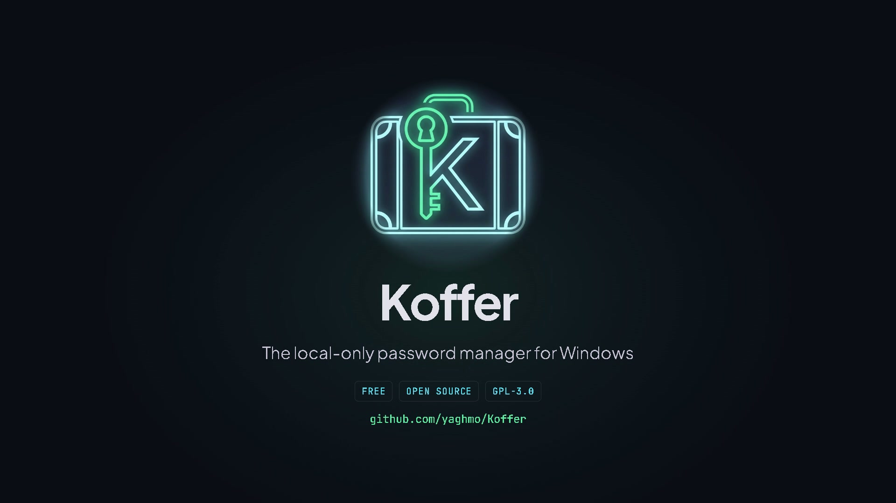

# Koffer

[](design/koffer-launch.mp4)

[](LICENSE)


[](extension/README.md)

Local-only encrypted password manager for Windows. Tauri + React.

## Features

- Logins, secure notes, and cards in one encrypted vault
- AES-256-GCM encryption with Argon2id key derivation
- Cryptographically secure password generator
- Auto-lock after 15-30 minutes of inactivity (configurable)
- Clipboard auto-clear (30s default)
- Vault file at rest is encrypted; safe to back up

## Requirements

- Windows 10/11
- Rust 1.75+ ([rustup](https://rustup.rs))
- Node.js 20+
- Tauri prerequisites: <https://tauri.app/start/prerequisites/>

## Develop

```bash
npm install
npm run tauri dev
```

## Build

```bash
npm run tauri build
```

Installer: `src-tauri/target/release/bundle/msi/`

## Test

```bash
npm test                    # frontend
cd src-tauri && cargo test  # backend
```

## Manual test checklist

1. First run → setup wizard → create master password
2. Vault view appears
3. Add a login (title, URL, username, password) → save
4. Lock button (top right) → returns to lock screen
5. Unlock with same password → login still there
6. Wrong password → "Wrong password. Try again."
7. Generate password → length slider, class checkboxes → Copy
8. Copy a password from a login → wait 30s → clipboard should be cleared
9. Idle (configurable minutes) → app auto-locks

## Security notes

- Master password is never stored; lose it = lose your vault
- Vault file is encrypted at rest; safe to back up
- Closing the window hides it to the tray; the vault stays unlocked until you lock it (tray or button) or auto-lock fires. Exiting from the tray locks and wipes first
- Master key lives in Rust memory only; never crosses the IPC boundary
- Network calls, all started by you: a site's title and favicon when you enter a login URL (public hosts only, size-capped), the opt-in leaked-password check (5 characters of a hash), and the opt-in backup to your own Cloudflare account. Vault contents are never sent in the clear. See `PRIVACY.md`.
- The browser extension talks to the app over `127.0.0.1:38471` (or the next free port, which the pairing code then names) — loopback only, and only after you pair it by hand. There is no shared token: the browser signs each request with a key its own JavaScript cannot export, and a password for a site it has not been approved for raises a dialog here first. `extension/README.md` has the whole model, including what it does not defend against.

## Out of scope (v1)

- Sync, mobile, multi-user
- Lock on Windows session lock (planned for v1.1)

## Browser extension

Fills, saves and offers 2FA codes in Chrome and Firefox, talking only to the
app on `127.0.0.1`. See [`extension/README.md`](extension/README.md).

**Try it without touching real accounts:** the
[test site](https://yaghmo.github.io/koffer/) has sign-in, sign-up,
two-step, phone, 2FA and "Sign in with…" pages. Everything on it is fake and
stays in your browser. `npm run testsite` serves the same pages locally.

## Contributing, security and privacy

- [CONTRIBUTING.md](CONTRIBUTING.md): how to build, test and send a change.
- [SECURITY.md](SECURITY.md): report vulnerabilities privately, never in an issue.
- [PRIVACY.md](PRIVACY.md): nothing is collected; the few network calls, all started by you.
- [CODE_OF_CONDUCT.md](CODE_OF_CONDUCT.md) and [CHANGELOG.md](CHANGELOG.md).

## Support

If this is useful to you, you can [sponsor its development](https://github.com/sponsors/yaghmo).

## License

Copyright (C) 2026 Yaghmoracen Belmir.

This program is free software: you can redistribute it and/or modify it under
the terms of the GNU General Public License as published by the Free Software
Foundation, either version 3 of the License, or (at your option) any later
version. It is distributed WITHOUT ANY WARRANTY; see [LICENSE](LICENSE) for
the full text.
